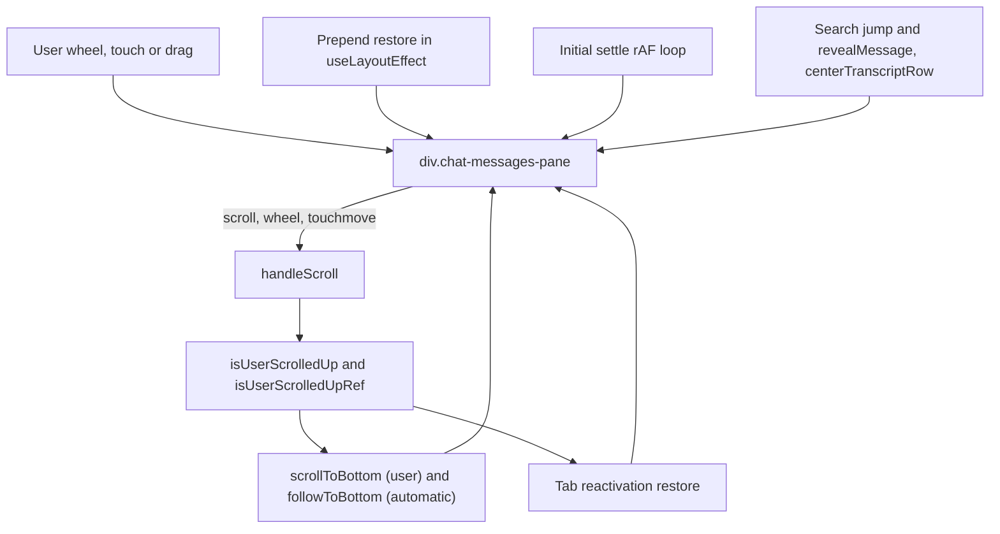
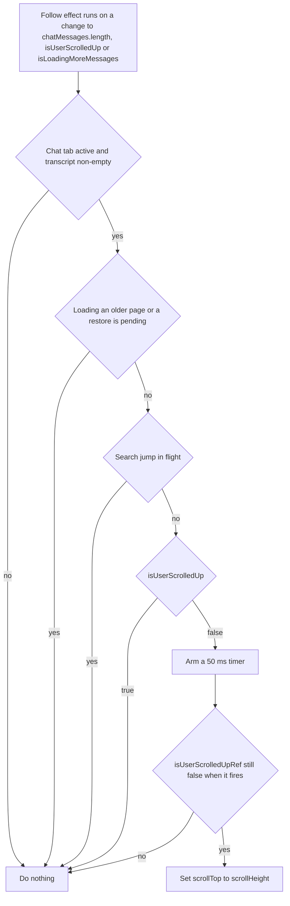
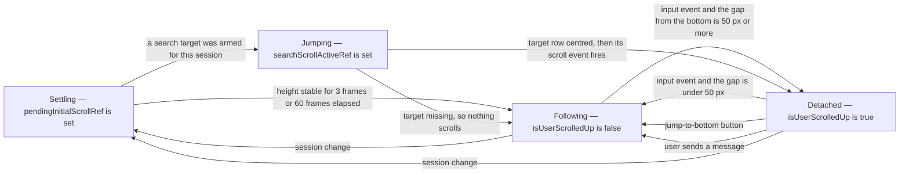
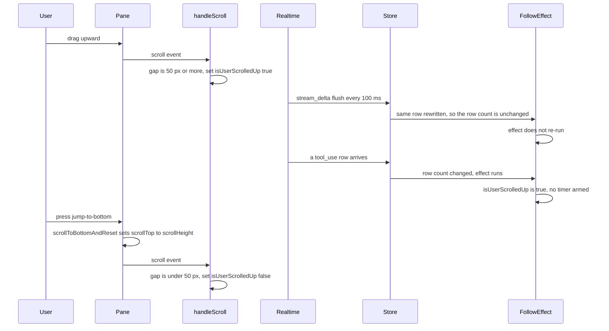
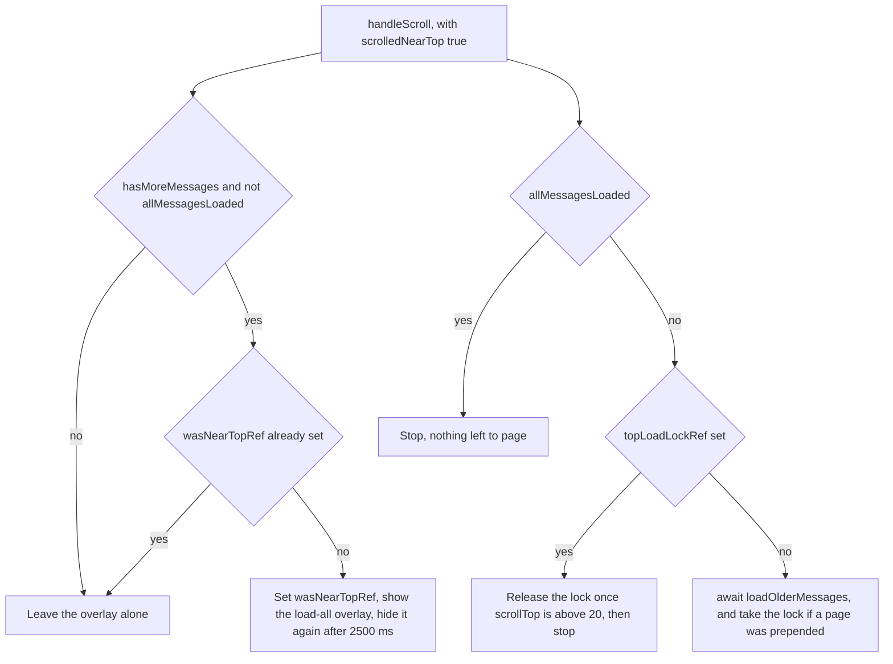

# Scrolling

*Where the transcript sits, who is allowed to move it, and the rules that stop the app from
fighting the user. Paging and row mounting are covered in
[the message store and lazy loading](./04-message-store-and-lazy-loading.md).*

## In one paragraph

The transcript is one scrolling `div`, and five separate pieces of code write its
`scrollTop`. There is no scroll controller and no state machine: the writers are
coordinated by a handful of refs that each one checks before acting. The shared truth is
`isUserScrolledUp` — `false` means "the user is parked at the bottom, keep them there",
`true` means "the user is reading, do not move them" — and it is recomputed only from
`scroll`, `wheel` and `touchmove`, never from a height change. Every deferred automatic
scroll re-reads that intent through `isUserScrolledUpRef` at the moment it fires, because
the value it was armed with may be seconds stale. Everything else — the settle after
opening a session, the position restore after older history is prepended, the jump to a
search hit — stakes a temporary claim in a ref that tells the other writers to stand down
until it is finished. The test file says it plainly: *"The transcript's scroll position is
written from five places coordinated by refs and timers rather than by one owner"*
(`src/modules/chat/tests/transcriptScrollOwnership.test.tsx`).

## Mental model

1. **One element owns the transcript position.** The `div.chat-messages-pane` rendered by
   `src/modules/chat/transcript/ChatMessagesPane.tsx`. A few rows contain their own capped
   scrollers (bash output, file lists, question panels) — those never move the transcript,
   and their native `scroll` events do not bubble, so they never reach `handleScroll`.
2. **The pane component holds no scroll state.** It takes `scrollContainerRef`, `onWheel`
   and `onTouchMove` as props. Every write to `scrollTop`, every threshold and every claim
   ref lives in `src/modules/chat/hooks/useChatSessionState.ts`. If you are reading
   `ChatMessagesPane.tsx` looking for scroll logic, you are in the wrong file.
3. **`isUserScrolledUp` is the only shared decision, and it has exactly three readers.**
   The append-follow effect, the tab-reactivation branch of the `useLayoutEffect`, and the
   jump-to-bottom button in `ChatInterface.tsx`. Predict from it: if the flag is `true`,
   no automatic scroll happens, and the round arrow button is on screen.
4. **The flag is only recomputed from an input event.** `handleScroll` runs on `scroll`,
   `wheel` and `touchmove`, and applies one test — `scrollHeight - scrollTop - clientHeight
   < 50`. Content that grows *below* the fold does not move `scrollTop`, emits no event, and
   therefore leaves the flag stale.
5. **A deferred scroll must re-read intent at fire time.** `isUserScrolledUpRef` mirrors
   the state so a timer armed 50 ms or 200 ms ago can ask whether the user has scrolled
   away since. Adding a timed scroll without that check reintroduces the bug
   `transcriptScrollOwnership.test.tsx` exists to catch.
6. **The follow effect re-runs on three things, not one.** Its deps are
   `chatMessages.length`, `isUserScrolledUp` and `isLoadingMoreMessages`. So a new *row*
   re-follows; a streamed rewrite of an existing row does not; and the flag flipping back
   to `false` also arms a scroll, which is what snaps you the last few pixels when you
   scroll back down.
7. **A claim ref suppresses the other writers.** `pendingInitialScrollRef`,
   `pendingScrollRestoreRef`, `searchScrollActiveRef`, plus two latches at the top of the
   list, `topLoadLockRef` and `wasNearTopRef`. A session change clears or re-arms all five
   in one effect.
8. **Row geometry does not change behind the user's back.** Lazy rows keep their measured
   height when their content unmounts, React keys are derived from intrinsic message fields
   rather than object identity, and when content above the viewport changes height anyway
   (a never-measured row mounting, a late image, the chrome above the first row), scroll
   anchoring holds the view still. Where the browser has it (Chromium, Firefox, Safari 27+)
   that is native `overflow-anchor`, with placeholders kept out of anchor selection; where
   it does not (Safari before 27), `useLazyRowObserver` does the same job in JS.

## The pieces

| File | Role |
| --- | --- |
| `src/modules/chat/hooks/useChatSessionState.ts` | Owns the scroll position. All five writers, `isNearBottom`, `handleScroll`, every claim ref, the search jump. |
| `src/modules/chat/transcript/ChatMessagesPane.tsx` | Renders the one scrolling element, binds the ref and the wheel/touch handlers it is handed, mounts the newest `INITIAL_MOUNTED_TAIL_ROWS` rows eagerly. |
| `src/modules/chat/ChatInterface.tsx` | Wires the hook to the pane, passes `handleScroll` as `onWheel`/`onTouchMove`, renders the jump-to-bottom button. |
| `src/modules/chat/hooks/useChatComposerState.ts` | `handleSubmit` clears `isUserScrolledUp` and scrolls to the bottom at +100 ms. |
| `src/modules/chat/transcript/LoadAllMessagesOverlay.tsx` | The "load all" pill that appears when the user reaches the top. |
| `src/modules/chat/transcript/LazyMessageRow.tsx` | Swaps a row's content for a placeholder of the same measured height, keeping an addressable wrapper. Marks placeholders with `data-lazy-placeholder` and reports each mount to `trackMountedRow`. |
| `src/modules/chat/hooks/useLazyRowObserver.ts` | One `IntersectionObserver` per pane, rooted at the scroll container, `LAZY_ROW_VIEWPORT_MARGIN_PX = 1200`. In browsers without native scroll anchoring it also anchors manually: a `ResizeObserver` plus `trackMountedRow` move `scrollTop` by the anchor row's drift. Exports `noteProgrammaticScroll`, which every writer in `useChatSessionState.ts` calls, through `writeTranscriptScroll`, after a write that moved the view, and which retakes the anchor right where the write landed. |
| `src/modules/chat/utils/searchTargetLocator.ts` | `findSearchTargetIndex` resolves a sidebar hit against loaded data; `resolveSearchWindowSize` sizes the render window. |
| `src/modules/chat/utils/messageKeys.ts` | `getIntrinsicMessageKey` — stable render keys, so a prepend does not remount the rows below it. |
| `src/index.css` | `.chat-messages-pane` / `.chat-message` containment, `width: 0` on `[data-lazy-placeholder]` where `overflow-anchor` is supported, mobile `touch-action`, document-level overscroll containment, `.search-highlight-flash` (held back while its row is a placeholder; its `search-flash` keyframes name is what ends it, see [jumping to a search hit](#jumping-to-a-search-hit); under `prefers-reduced-motion` it keeps its 4 s, since it only changes colours). |
| `src/modules/project-workspace/hooks/useVisualViewportKeyboardOffset.ts` | Publishes `--keyboard-height` so the shell shrinks above the iOS keyboard. |
| `src/shared/ui/ScrollArea.tsx` | **Not used by chat.** `FileTree.tsx` and `SidebarContent.tsx` only. |
| `src/modules/chat/tests/transcriptScrollOwnership.test.tsx` | Pins the two ownership bugs — the deferred scroll and the cross-session search jump. |
| `src/modules/chat/tests/lazyMessageRow.test.tsx` | Pins placeholder height and the hidden-tab zero-rect case. |
| `src/modules/chat/tests/transcriptScrollAnchoring.test.tsx` | Pins the manual anchoring path (`CSS.supports` stubbed false): the view stays still when rows or chrome above it resize, plus the cases it must leave alone, the prepends with and without a restore, and the scroll listener's row reads and their exact boundaries. Part of it renders the real `useChatSessionState` around the rows, so its writers and restore effect run in the same commits as the anchoring, including a swap committed after a writer's move but before its `scroll` event, and a write that moved nothing over a change not yet reported. Also pins that it writes nothing where native anchoring exists, the `data-lazy-placeholder` marker, that a writer's note reaches the observer that hooked onto the pane last (an earlier one unhooking leaves its registration alone, and one that unhooked leaves nothing for a note to run), and the stylesheet rules (the scoped `width: 0`, the held-back highlight, the highlight's full 4 s under reduced motion, no `content-visibility` on any `.chat-message` rule). |
| `src/modules/chat/tests/revealMessageRetries.test.tsx` | Pins `revealMessage` waiting for the exact row, centring by writing the pane's own `scrollTop` (never `scrollIntoView`), the centring frames and everything that stops them, everything that stops a lookup still waiting for its row (reveal, search, a New Session click), the search jump's fetch being stoppable the same way, a search landing behind another tab waiting for the tab's return, the search claim being released once the jump lands or runs out of retries (and kept by a second search taking over), the highlight lasting until its flash ends, a second jump onto a row still flashing restarting its flash, a reveal flashing too, the jump ending the initial settle, and which writes are noted (`noteProgrammaticScroll` spied), the tab return included. Also that an automatic follow to the bottom (a refresh after an external update, a follow armed just before the click) neither drops a search still fetching its transcript nor writes while it is pending, while the user's `scrollToBottom` does drop it; that an external update is refreshed once, not again for a new object of the same session; that a stopped search still records its loaded transcript (`hasMoreMessages` false, `allMessagesLoaded` true) and is not put back for a hidden tab's return, whether its fetch loaded, failed or threw; that a search put back behind a hidden tab is dropped by a session change there; and centring in a pane that starts below the top of the page. Its pane lays rows out in content coordinates, and a write that leaves a row centred counts as a jump to it. |
| `src/modules/chat/tests/scrollRestoreGuards.test.tsx` | Pins the prepend restore and what arms it: `widenVisibleWindow`'s guards (no restore for a row already in the window, behind another tab, or over a pending one), "Load earlier" twice before a render, "Load all" landing (window, flag, restore) and failing (nothing armed, paging left open), a failed older page, a search fetch that fails or errors falling back to the messages already loaded, and the session guards on "Load all", an older page and the search jump, including a switch away and back while the request is in flight and that such a request's loading flags do not hold up or end the reopened session's own loads, nor a New Session click's next page. Also that a failed whole-transcript fetch fails the export, and that a failed first page leaves the open's paging alone. |
| `src/modules/chat/tests/sessionStoreFetchOutcome.test.ts` | Pins that `fetchFromServer` reports each call's own outcome: a failed request reads as failed although a refused call queued behind it has already set the shared slot's `status` back to `'idle'`. |
| `src/modules/chat/tests/searchTargetLocator.test.ts` | Pins snippet-first resolution, the timestamp fallback and the window size. |

### Who writes `scrollTop`

All five are in `useChatSessionState.ts`. A repo-wide grep for `scrollTop =`, `scrollTop +=`,
`scrollIntoView` and `scrollTo(` finds one more transcript writer, `useLazyRowObserver.ts`,
which writes only in browsers without native scroll anchoring. It is not a destination but a
correction: it moves `scrollTop` by however far the row on screen drifted, so what the user
sees stays put. Each of the five writers writes through `writeTranscriptScroll`, which calls
`noteProgrammaticScroll(container)` when the write moved `scrollTop`; that makes the
correction retake its anchor where the write landed instead of adding a drift on top of it. See
[keeping the view still](#keeping-the-view-still-above-the-viewport). The remaining hits are
all outside the transcript: the composer (its textarea highlight overlay and mention
dropdown), the command menu, the workspace tabs, the sidebar, the shell and the code editor.

## The single scroll container

**RULE: one element scrolls the transcript, and the component that renders it holds no
scroll state.**

`ChatMessagesPane` renders a single `div` with `ref={scrollContainerRef}`,
`onWheel={onWheel}`, `onTouchMove={onTouchMove}` and the classes
`chat-messages-pane relative min-h-0 flex-1 overflow-y-auto overflow-x-hidden`, then a
`max-w-[54.25rem]` inner column of rows. The export menu inside it is
`sticky right-4 top-3`, which is why it stays put while the list moves. The pane is
`memo`ised, and neither it, `MessageComponent`, nor any tool view reads or writes a scroll
offset.

Three row-level scrollers do exist — `BashCommandDisplay.tsx` (`max-h-80 overflow-auto`),
`FileListContent.tsx` and `AskUserQuestionPanel.tsx` (`max-h-48 overflow-y-auto`). They are
harmless: a native `scroll` event does not bubble, so the pane's `scroll` listener never
sees them. Their `wheel` and `touchmove` events *do* bubble into `handleScroll`, which
reads the pane's own `scrollTop`/`scrollHeight` and so simply re-measures the unchanged
transcript.

`src/shared/ui/ScrollArea.tsx` is a different component with a nested inner scroller and
`touchAction: 'pan-y'`. Chat does not use it. If you are debugging chat scrolling,
`ScrollArea` is a dead end.

**Why `onWheel` and `onTouchMove` sit next to a real `scroll` listener.** They look
redundant. The comment on the `ChatMessagesPane` call site in `ChatInterface.tsx` records
why they are not: a first page is `SESSION_MESSAGES_PAGE_SIZE = 20` rows, tool results fold
into their calls, and the "load earlier" link is hidden while more pages exist — so a short
transcript is often **not scrollable at all and never emits `scroll`**. Wheel and touch are
then the only way for the user to reach the top pager or the "load all" overlay.

## Staying at the bottom

**RULE: the user is "at the bottom" when fewer than 50 px of content sit below the fold.**

`useChatSessionState.ts` → `isNearBottom` returns
`scrollHeight - scrollTop - clientHeight < 50`, and `false` when there is no container.
`handleScroll` calls it on every `scroll`, `wheel` and `touchmove` (after bailing out when
the Chat tab is inactive), writes `setIsUserScrolledUp(!nearBottom)`, and records the
current `{height, top}` into `scrollPositionRef` for the tab-reactivation restore. A
separate effect mirrors the state into `isUserScrolledUpRef` — an effect rather than an
assignment beside each setter, because `setIsUserScrolledUp` is also returned from the hook
and called by the composer.

**RULE: an append only scrolls when the user has not scrolled away, and it re-checks
before it moves.**

That is the whole auto-follow. Note what re-runs it. A new **row** re-follows; the 100 ms
streaming flushes that rewrite an existing row in place do not (see the gotchas). And
because `isUserScrolledUp` is a dependency, dropping back inside the 50 px band arms one
more scroll that finishes the trip to the bottom.

### Follow and detached

`Settling` and `Jumping` are claims held in refs, not values of the flag. Note the last
`Jumping` edge: when a jump resolves to nothing, `searchScrollActiveRef` clears but the
initial settle has already been consumed, so the transcript stays wherever it rendered with
the flag still `false`. The same goes for a search jump that is stopped before it lands (by
the user's `scrollToBottom`, the user's own input on the pane, a newer jump, or running out of
retries): stopping it releases the claim, so the follow works again. Only a jump put back to
wait for a hidden Chat tab keeps it. The follow itself never stops a jump: while one is
pending it does nothing (see [deferred scrolls](#deferred-scrolls-re-check-intent)).

### Scrolling up mid-stream, and getting back

**RULE: the only ways back are explicit — scroll down, press the button, or send a
message.**

While `isUserScrolledUp` is true, `ChatInterface.tsx` renders one round `ArrowDownIcon`
button floating just above the composer, gated on `isUserScrolledUp && chatMessages.length > 0`.
There is **no unread count and no new-message indicator**; the button is the whole
affordance.

Its handler is `scrollToBottomAndReset`, not `scrollToBottom`. The difference matters: when
`allMessagesLoaded` is set (the user pulled the whole transcript in), it also drops
`visibleMessageCount` back to `INITIAL_VISIBLE_MESSAGES = 100` and clears
`allMessagesLoaded`. Jumping to the bottom throws away the widened render window on
purpose — the window only existed to reach something far up.

## Deferred scrolls re-check intent

**RULE: a scroll armed on a timer must re-read `isUserScrolledUpRef` before it moves
anything.**

| Where | Delay | Re-checks? |
| --- | --- | --- |
| Append follow effect (`useChatSessionState.ts`) | 50 ms | yes: it fires `followToBottom`, which checks `isUserScrolledUpRef` and that no jump is pending |
| External-update refresh (same file, the `externalMessageUpdate` effect) | 200 ms | yes: the same `followToBottom`, and only armed when `isNearBottom()` held before the refetch |
| Composer send (`useChatComposerState.ts` → `handleSubmit`) | 100 ms | **no**: it sets the flag false itself, then calls `scrollToBottom()` unconditionally |

**RULE: only the user's own way to the bottom stops a jump.** `scrollToBottom`, the one the
hook returns, is the user's: the jump-to-bottom button (`scrollToBottomAndReset`) and a sent
message. It cancels a pending jump (`cancelPendingJump`) and writes the bottom. A pending
jump there includes a search hit armed but not started yet (its claim and `searchTarget`
set, its jump waiting for the session's first page or for the Chat tab): `cancelPendingJump`
clears both, so the hit never lands. The two
automatic follows go through `followToBottom` instead, which writes the bottom only when no
jump is pending, that is when no search holds its claim (`searchScrollActiveRef`, set from
the click through its whole-transcript fetch to landing) and no jump is running
(`stopJumpRef`, its lookup or its re-centring), and never cancels one. Both read it when the
timer fires, not when it was armed: a search clicked inside the delay starts its jump before
its fetch, and an automatic follow cancelling it there dropped the jump the user had just
asked for (a follow armed by a new message, or a refresh after an external update, landing
while a slow transcript fetch was still in flight). A follow declined while a jump is
pending is not retried; the next new row arms another. A search jump that gives up without
landing (its hit is not in the transcript, or no row turned up by the last attempt) has held
the follows and the initial settle off meanwhile, so it calls `followToBottom` once itself
(`giveUp`, after releasing its claim), which lands at the bottom unless the user is
scrolled up. A jump stopped by the user, a newer jump or a session change does not.

The external-update effect is keyed on `externalMessageUpdate` alone and reads the selected
session, the project and `isProcessing` through a ref. It used to list the session object,
so once the count was above zero every new object for the same session (a sidebar search
click hands over one) refreshed again and armed another follow over the jump that click had
just started.

The first two used to fire unconditionally. Commit `a1a42774` describes the failure:
scrolling up inside the delay was silently undone, and because a programmatic scroll itself
emits a `scroll` event, the resulting `handleScroll` reset `isUserScrolledUp` to false and
hid the jump-to-bottom button too. The user was returned to the bottom *and* lost the
control that would have explained why.

`transcriptScrollOwnership.test.tsx` pins both directions on fake timers, driving the real
hook against a hand-built container (jsdom has no layout, so `scrollHeight`/`clientHeight`
are stubbed and `scrollTop` writes are recorded):

- *"does not yank the view back down when the user scrolls up inside the delay"* — appends
  a row, flips the flag, advances 200 ms, asserts **zero** writes.
- *"still sticks to the bottom when the user has not scrolled away"* — same setup without
  the flip, asserts a write of `scrollHeight`.

The test stubs `requestAnimationFrame` to a no-op on purpose: the initial-settle loop is a
separate writer that would otherwise satisfy an assertion meant for the timer.

The composer send is deliberately unguarded — the user pressed Enter, so the intent is
fresh. The cost is that scrolling up within 100 ms of sending is undone.

## Reaching the top: the pager, the lock and the overlay

**RULE: the top 100 px is a trigger zone, and it fires at most once per visit.**

The second half of `handleScroll` computes `scrolledNearTop = container.scrollTop < 100`
and runs two independent latches off it.

- **`wasNearTopRef`** debounces the overlay so it appears once when the user arrives at the
  top, not on every scroll event there. It is cleared as soon as `scrolledNearTop` goes
  false. The 2500 ms hide timer in the hook is matched by the overlay's own
  `loadAllOverlayAutoFade 2500ms` animation in `LoadAllMessagesOverlay.tsx`, so the pill
  fades out exactly as the state clears.
- **`topLoadLockRef`** stops a page load from immediately triggering the next one. After a
  successful prepend the restore leaves you near the top again, which would satisfy
  `scrolledNearTop` on the very next event. The lock is only released once
  `container.scrollTop > 20` — the user must actively move away from the very top before
  another page is fetched. Note the asymmetry: entering the zone is `< 100`, leaving the
  lock is `> 20`.

`loadAllMessages` (the overlay's button) takes a different path: it fetches the whole
transcript with `limit: null`, sets `visibleMessageCount` to `Infinity`, captures a scroll
anchor first, and shows a green "all loaded" pill for 2500 ms.

## Restoring position after a prepend

**RULE: prepending rows must not move content under the user's eyes. Position is restored
from an anchor element, not from a scroll offset.**

`loadOlderMessages` calls `captureScrollRestoreState(container)` *before* the fetch. That
records four things: `scrollHeight`, `scrollTop`, an anchor element, and that anchor's
offset from the container's top edge. The anchor is the first `.chat-message` whose
`getBoundingClientRect().bottom` is at or past the container's top edge — in plain terms,
the topmost row that is not entirely scrolled off.

After `sessionStore.fetchMore` reports `prependedCount > 0`, the captured state is parked in
`pendingScrollRestoreRef` and `visibleMessageCount` grows by `SESSION_MESSAGES_PAGE_SIZE`. A
`useLayoutEffect` — before paint — drains it:

| Case | Correction |
| --- | --- |
| Anchor still in the DOM (`anchor.isConnected`) and its offset was recorded | `scrollTop += newAnchorOffset - oldAnchorOffset` |
| No anchor, or it is gone | `scrollTop = oldTop + max(newScrollHeight - oldHeight, 0)` |

The anchor path is the accurate one; the height-delta path is the fallback. What keeps the
anchor alive across the prepend is **stable keys**: `ChatMessagesPane` builds a
`messageKeyMap` each render from `getIntrinsicMessageKey`, disambiguated by occurrence index
on collision. Its comment states the reason — a server refresh replaces source records with
equivalent new objects, so object identity is not a durable React key across pagination or
hydration. The key falls back through `id`, `messageId`, `toolId`, `toolCallId`, `blobId`,
`rowid`, `sequence`, and only then to a timestamp-plus-content-prefix string.

The same mechanism is reused by `loadAllMessages`, and by `widenVisibleWindow`, which the
search jump, `revealMessage` and `loadEarlierMessages` call: widening the window puts rows in front of the
first one just like a page of older messages, so it captures a restore (unless one is
already pending) before `visibleMessageCount` grows. That is why the restore
`useLayoutEffect` is keyed on `visibleMessageCount` as well as `chatMessages.length`: a
widened window changes no message count. While `pendingScrollRestoreRef` is set,
the append-follow effect declines outright — a prepend must never be mistaken for an
append — and the restore branch of the `useLayoutEffect` returns early, so a pending restore
also beats the tab-reactivation restore in the same commit.

## Opening a session, switching, and coming back

**RULE: each programmatic scroll stakes a claim, and every other writer checks it.**

| Trigger | Mechanism | Claim ref |
| --- | --- | --- |
| Opening a session | rAF settle loop | `pendingInitialScrollRef` |
| Returning to the Chat tab | `useLayoutEffect` reactivation branch | — |
| Older page prepended | `useLayoutEffect` restore branch | `pendingScrollRestoreRef` |
| Window widened for a search hit or a reveal | `useLayoutEffect` restore branch, via `widenVisibleWindow` | `pendingScrollRestoreRef` |
| Sidebar search hit | full fetch, retry chain, then `centerTranscriptRow`; ends the initial settle | `searchScrollActiveRef` |
| `revealMessage` (background-tasks strip) | rAF retry chain, then `centerTranscriptRow`; ends the initial settle | none |
| Expanding a tool view | nothing — pure layout change | — |

### Opening a session

A single `scrollToBottom()` at +200 ms used to be enough. It is not: markdown blocks, code
highlighting and images finish rendering after that window, `scrollHeight` grows, and
nothing re-anchors — the tab opens visually "scrolled way up" with the newest assistant
message off screen. The current effect runs a `requestAnimationFrame` loop that sets
`scrollTop = scrollHeight` **every frame**, counting frames and consecutive stable heights;
it stops at **3 consecutive stable frames or 60 frames (~1 s)**, whichever comes first, and
then clears `pendingInitialScrollRef`. The loop is cancelled by the effect's own cleanup
calling `cancelAnimationFrame`; the session-change effect *re-arms*
`pendingInitialScrollRef` to `true` rather than clearing it.

It is helped by `INITIAL_MOUNTED_TAIL_ROWS = 30` in `ChatMessagesPane.tsx`: the newest 30
rows mount with real content on the first commit, so the loop measures real heights at the
bottom rather than placeholder estimates.

The loop declines entirely if `searchScrollActiveRef` is set — a session opened from a
search hit is not supposed to land at the bottom. A jump that starts while the loop is still
running (a `revealMessage`, or a search hit in the session already open) clears
`pendingInitialScrollRef` itself: otherwise the loop writes the bottom every frame while the
jump re-centres its row, and since the loop can run 60 frames to the jump's 20, the reveal
ended at the bottom.

### Switching sessions

The session-change effect (keyed on `selectedProject?.projectId` and `selectedSession?.id`)
starts a new open by bumping `sessionOpenRef`, stops any running jump through
`cancelPendingJump` (a reveal or search lookup still waiting for its row, or a re-centring
loop) and drops a search hit not started yet (`cancelPendingJump` clears
`searchScrollActiveRef` and `searchTarget` too), nulls `pendingScrollRestoreRef`,
clears `topLoadLockRef` and `wasNearTopRef`, re-arms `pendingInitialScrollRef`, resets
`visibleMessageCount` to `INITIAL_VISIBLE_MESSAGES`, sets `isUserScrolledUp` to false, and
clears the loading flags (`isLoadingSessionMessages`, `isLoadingMoreRef`,
`isLoadingMoreMessages`, `isLoadingAllMessages`): a first page, an older page or a "Load
all" still in flight belongs to the open being left, and leaves them alone when it lands, so it neither holds up the new open's own loads
nor ends them. The New Session reset bumps `sessionOpenRef`, calls `cancelPendingJump` and
clears the loading flags too, since a click on the same route does not run the
session-change effect. The session-change effect's comment records that ordering is
load-bearing: the effect that reads `__searchTargetSnippet` off the newly selected session
runs *after* this one, so a session opened *from* a search result re-arms immediately.

`sessionOpenRef` counts opens, not sessions. A request captures it before its await and
checks it after, together with the session id (`isSameSessionOpen`): leaving a session and
coming back to it mid-request makes the id match again, and the old request used to arm
its restore, its `Infinity` window, its page or its jump on the fresh open, during that
open's initial settle.

### Returning to the Chat tab

The chat tree stays mounted behind Tailwind's `hidden` (`display: none`) when another
workspace tab is active (`WorkspaceMain.tsx`, which also passes `isActive`). An effect with
no dependency array records `{height, top}` into `scrollPositionRef` after every render
while the tab is active, and the `useLayoutEffect` reactivation branch — recognised through
`wasChatActiveRef` — restores `scrollPositionRef.current.top` when detached, or
`container.scrollHeight` when following, through `writeTranscriptScroll` like every other
writer. Hidden tabs must not reset pagination or scroll: `handleScroll`, the restore branch
and the settle loop all bail out on `!isActive`. A search jump that finds the tab hidden once
its transcript has loaded, or when it is about to land, has nothing to centre its row in: it
stops its lookup, keeps `searchScrollActiveRef` and puts its target back in `searchTarget`,
and the search effect (which declines while the tab is hidden and re-runs on `isActive`)
lands it when the tab is shown again. A session change while it waits drops it like any
other jump (the target and the claim are cleared), so on return it neither lands nor
flashes in the session now open, and that session follows its new messages. A jump stopped
while its transcript loaded is not put back, even if the tab is hidden by then: it returns
before that check.

## Jumping to a search hit

**RULE: resolve the target in the data first; only then look for its row, and only ever by
exact timestamp until the final try.**

The sidebar (`Sidebar.tsx`, `onConversationResultClick`) puts `__searchTargetSnippet` and
`__searchTargetTimestamp` on the selected session object. The jump then:

1. Sets `searchScrollActiveRef` — the initial settle and the append-follow both stand down.
   The arming effect requires a non-empty snippet string; without one there is no jump.
   The search effect then starts the jump (`startJump`, see below) before anything else, so
   it can be stopped from the first moment, its fetch included.
2. Fetches the **entire** transcript into the store (`limit: null`) so an old hit is
   reachable, without rendering all of it. If the user has switched sessions by the time it
   lands (or away and back), the jump ends there, before it touches any state, whether the
   fetch resolved or failed (see the gotchas). Otherwise a transcript that loaded is
   recorded (`hasMoreMessages` false, `totalMessages`, the offset, `allMessagesLoaded`)
   even if the jump was stopped meanwhile (the user's `scrollToBottom`, the user's own input
   on the pane, a newer reveal or search), because the store holds it either way, and paging
   on from the first page would ask for rows it already has; only then does a stopped jump
   end, without stopping the one that replaced it. A failed fetch (`ok: false`, which is how
   the store reports one, or a throw) loads nothing more, so the jump looks for its hit in
   the messages already loaded. If the Chat tab is hidden by then, the jump waits
   for it (see [returning to the Chat tab](#returning-to-the-chat-tab)), and so it does if
   the tab is hidden on any later attempt.
3. Resolves the index against the loaded data, not the DOM:
   `searchTargetLocator.ts` → `findSearchTargetIndex`. The snippet is authoritative —
   normalised, ellipsis-stripped, lower-cased, `MIN_SNIPPET_LENGTH = 10`,
   `MAX_SNIPPET_LENGTH = 80`, matched against `displayText`, `content`, string `toolInput`
   and string tool-result content. **Only if the snippet misses** does the timestamp take
   over, and it returns the *nearest* message by time, not an exact match. `-1`, and
   therefore no jump at all (only the one follow to the bottom of a jump that gives up),
   happens only when the snippet misses *and* there is no finite timestamp. `searchTargetLocator.test.ts` pins both halves: *"a snippet that
   matches nothing reports a miss instead of guessing"* and *"the timestamp is only a
   fallback when the snippet misses"*.
4. Widens the render window with
   `resolveSearchWindowSize(count, index, SEARCH_TARGET_CONTEXT_MESSAGES = 20)`, applied
   through `widenVisibleWindow` as `Math.max(previous, required)` so the window never
   shrinks. `visibleMessages` is a tail slice, so covering index N means rendering
   everything after it. Widening captures a scroll restore, so the view stays where it was
   until the jump moves it.
5. Waits 150 ms for React to commit, then looks the row up by `data-message-timestamp` and
   lands on it through `jumpToTranscriptRow`: `centerTranscriptRow`, and
   `flashTranscriptRow`, which adds the `search-highlight-flash` class. The row found is the
   `LazyMessageRow` wrapper, which may still be a placeholder (no width where the browser
   anchors), so `index.css` sets `animation: none` on
   `.search-highlight-flash[data-lazy-placeholder]`: the flash starts when the row mounts
   and the marker goes, instead of playing on a 0px strip. The class comes off when the
   row's own `search-flash` animation ends (`animationend` with that `animationName` and the
   row as its target, not one bubbling up from inside it, and only after that flash's own
   `animationstart`), or `ROW_FLASH_MAX_MS = 10_000` after the jump. That fallback is what
   takes the class off a row that never mounted; it also cuts short the flash of a row that
   mounts more than `ROW_FLASH_MAX_MS` minus the 4 s flash after the jump, which then plays
   only for what is left of the 10 s. A fixed 4000 ms timer used to cut the flash short on
   every row that mounted late. A jump onto a row still flashing restarts its flash: taking
   the class off and putting it straight back is no change to the browser, which lets the
   running animation carry on, so `flashTranscriptRow` reads `offsetWidth` in between, with
   the class off. The earlier flash's `animationend` may already be queued then; it comes
   before the restarted flash's `animationstart`, which is why an end only counts after a
   start. Under `prefers-reduced-motion` the global 0.01 ms animation rule would make the
   highlight invisible, so `index.css` gives `.search-highlight-flash` its 4 s back inside
   that media block (both rules read `--search-flash-duration`, set on the class) (it only changes colours); `animationend` still ends it then.
   `revealMessage` lands through the same function, so a row revealed from the
   background-tasks strip flashes too.

**The lookup can be stopped like the re-centring.** Both phases of a jump, looking for its
row and re-centring it, run under `startJump`, which stops the jump running before it,
registers its own stop in `stopJumpRef` and stops on the user's own input on the pane. Both
lookups (the search's fetch and timer chain, and `revealMessage`'s frame chain) start
through it, and so does `centerTranscriptRow`, which thereby ends the lookup that found its
row. Each attempt checks it is still the running jump first. Left running, a lookup's last
attempt settles for the nearest row, which by then can be any row of whatever the view
shows, in another session too; it would jump there, start a re-centre and end that
session's initial settle. A stopped search lookup clears `searchScrollActiveRef`, so the
follow and the settle are not held off by a jump that will never land; the one exception is
a jump put back to wait for a hidden Chat tab, which keeps the claim until it lands. A
lookup that gives up (no hit in the transcript, or no row by its last attempt) then follows
the bottom once (see [deferred scrolls](#deferred-scrolls-re-check-intent)).

**`centerTranscriptRow`** centres the row instantly by writing the pane's own `scrollTop`
(`centerRowInPane`: the row's middle to the middle of the pane's client box), then checks
the row's position every frame for up to `CENTER_SETTLE_FRAMES = 20` frames and centres it
again whenever it moved, because the rows around it mount and replace their estimates after
the jump. It used `scrollIntoView({ block: 'center' })`, which also scrolls every scrollable
ancestor, up to 21 times per jump. It stops:

- after `CENTER_STABLE_FRAMES = 3` frames in which the row did not move;
- when the row leaves the DOM;
- on the user's own input on the pane (`wheel`, `touchstart`, `pointerdown`, `keydown`);
- when the next jump starts, the user's `scrollToBottom` runs (the button, a sent message),
  the session changes, a New Session click resets the transcript, or the transcript
  unmounts (`stopJumpRef` holds the running jump's stop, and `cancelPendingJump` calls it).
  Following new output on its own (`followToBottom`) does not stop it: it declines while
  the jump is pending and is not retried.

The lookup before it stops on the same things. So a jump never pulls the view back from the
user, from the bottom or from a newer hit. Starting
a jump also ends the initial settle (see [opening a session](#opening-a-session)).
`revealMessage` uses the same function after widening the window the same way. Smooth scrolling was dropped: it aims at estimated row heights, and
any programmatic correction during the animation aborts it. Measured before the change,
long jumps landed 1k to 14k px off target.

**The retry budget.** `SEARCH_SCROLL_RETRIES = 20` is the starting value of `retriesLeft`,
and there is a leading `setTimeout` before the first attempt, so the chain is **21 attempts
spaced `SEARCH_SCROLL_RETRY_DELAY_MS = 150` apart — about 3.15 s in total**. The budget is
that long because widening the window can commit thousands of rows that each run the
markdown pipeline.

**Why `allowNearest` exists.** `findRenderedMessageElement` is called with
`allowNearest = (retriesLeft === 0)`, so every attempt but the last accepts an **exact**
timestamp match only. The final attempt relaxes to nearest-by-time because a hit on the
second or later call inside a collapsed tool group has no row of its own:
`groupConsecutiveTools` stamps the group item with the **first** message's timestamp
(`toolGrouping.ts`), so the group row is the nearest match, never an exact one.

### Expanding a tool view

Nothing scrolls. There is no `scrollIntoView` anywhere under
`src/modules/chat/transcript/` or the tool renderers. Expansion is a layout change that scroll
anchoring absorbs: native anchoring where the browser has it, otherwise
`useLazyRowObserver`, whose anchor is the topmost mounted row on screen, so that row keeps
its top and grows downward while growth in rows above it is absorbed. If the row later
unmounts, `LazyMessageRow` records the expanded height first.

## Lazy rows and height stability

**RULE: unmounting a row's content must not change the scroll geometry.**

`LazyMessageRow` wraps every transcript row in a permanent lightweight `div` carrying
`data-message-timestamp`. The expensive subtree mounts only while the row is within
`LAZY_ROW_VIEWPORT_MARGIN_PX = 1200` of the viewport, tracked by one shared
`IntersectionObserver` per pane rooted at the scroll container (`useLazyRowObserver.ts`).

Three details exist purely to protect the scroll position:

1. **Measure before unmount.** `handleNearViewportChange` reads the exact rendered height
   (`getBoundingClientRect`, so 0px and fractional heights too) *while the
   content is still in the DOM*, then renders the placeholder at exactly that height. A row
   you have already seen costs nothing in geometry to scroll back through.
2. **The wrapper stays addressable.** The search jump queries `[data-message-timestamp]`,
   which the wrapper carries whether or not its content is mounted. **This does not extend
   to the prepend anchor:** `captureScrollRestoreState` queries `.chat-message`, and that
   class is on `MessageComponent` / `ToolGroupContainer`, *inside* the wrapper's children —
   so the anchor scan only ever picks a currently mounted row. It works in practice because
   the rows around the viewport are exactly the mounted ones.
3. **Zero-sized rects are ignored.** A hidden Chat tab (`display: none`) reports
   `isIntersecting: false` with a `0x0` rect. Treating that as "scrolled away" would wipe
   every row's mounted state and its measured height. `lazyMessageRow.test.tsx` pins this
   as *"ignores the zero-rect non-intersections a hidden tab reports"*.

### Keeping the view still above the viewport

**RULE: when content above the viewport changes height, the content on screen stays where
it is. Native scroll anchoring does this where the browser has it; `useLazyRowObserver`
does it everywhere else.**

Rows never yet measured use `ESTIMATED_ROW_HEIGHT_PX = 100`, so mounting one changes its
height: a short tool row shrinks by ~75px, a long reply grows by a thousand. Scrolling up
mounts such rows 1200px above the viewport, and a prepended page arrives as twenty of them
right above it. Late images, markdown settling, rows leaving the window and the chrome above
the first row (background-tasks strip, paging notices, the load-all pill) shift content
the same way.

**Browsers with scroll anchoring (Chromium, Firefox, Safari 27+).** Native `overflow-anchor`
does the work; the code never writes `scrollTop` for it. The one thing it gets wrong on its
own is the anchor choice: after a prepend it picks the blank placeholder straddling the top
edge, which is exactly the row whose growth has to be absorbed. So `LazyMessageRow` marks
placeholders with `data-lazy-placeholder`, and `src/index.css` gives them `width: 0` inside
`@supports (overflow-anchor: auto)`. Anchor candidates need area, so the browser skips them
and anchors to the first real row. Safari before 27 does not match the `@supports`, so its
placeholders keep their full width: the manual path never anchors to a placeholder anyway,
and a full-width box keeps WebKit's `IntersectionObserver` away from targets with no area.
Nothing on the manual path relies on placeholders being 0 wide. The one difference is a
placeholder measured at 0px tall: it is W x 0 there instead of 0x0, so the observer's 0x0
skip no longer catches its "far" report, which goes through as it did before `width: 0`
existed. It is already a placeholder, so it only stores the same 0px and the same state, and
React renders nothing new.

The obvious alternative, `overflow-anchor: none` on placeholders, does not work. A row
flipping back to `auto` as it mounts makes Chromium clear the pane's anchor
(`LayoutObject::StyleDidChange` calls `ClearAncestorScrollAnchors`), and the same commit's
height change on that row then goes uncorrected. After a prepend the view jumped 2k to 3k px
in 5 to 6 of 9 prepends that way (8 of 9 on the old main). With `width: 0`, 0 of 9 jump.

**Browsers without it (Safari before 27).** `useLazyRowObserver` checks
`CSS.supports('overflow-anchor', 'auto')` once per hook instance; when that is false it
anchors manually:

- **The anchor** is the topmost mounted row on screen, with its top stored in content
  coordinates (offset from the viewport top plus `scrollTop`), so scrolling alone does not
  change it. A row with no height (a hidden thinking row) is never chosen: it never
  straddles the top, so it would be retaken on every scroll event, and native anchoring
  skips boxes with no area too, so when it starts rendering the row below it stays put.
- **Corrections** add the anchor's drift in content coordinates to the *current*
  `scrollTop`. The drift does not depend on where the view is, so this holds even when the
  user has moved `scrollTop` and its `scroll` event has not fired yet, which Safari does
  for trackpad and iOS momentum scrolls. They run from a `ResizeObserver` callback, which
  arrives after layout and before paint, and from `trackMountedRow`, which `LazyMessageRow`
  calls from a layout effect in the commit that swaps a placeholder for content. The
  `ResizeObserver` watches mounted rows, the row column and the pane's children, each
  observed once. Placeholders are not observed: they change size only when they swap,
  which `trackMountedRow` handles, and rows leaving the DOM show up as the column resizing.
  After each correction the anchor is retaken.
- **One hold per commit.** Every row of a commit is in the DOM before any of its layout
  effects runs, so the first swap's `trackMountedRow` holds and retakes the anchor for the
  whole commit; the rest only register their row (`runOncePerCommit`). Strictly that is
  once per task: the flag holds until the next microtask checkpoint, which comes after
  every row of the commit has run its layout effects. A later commit in the same task is
  skipped, and is held by the `ResizeObserver`'s first report on its rows instead. Rows
  that mount without replacing a placeholder while there is no anchor (a session switch
  remounts the tail) look for one the same way, once per commit, under a flag of their own
  so they never skip a swap's hold, and the look for new chrome to observe runs once per
  commit under a third. Retaking reads every mounted row's box, so per-row retakes cost a
  long "Load all" commit rows times mounted rows. The `ResizeObserver`'s first report on
  each newly observed row then retakes the anchor among all of them before paint.
- **The browser's own clamp is credited.** When content shrinks under the bottom of the
  view, the browser lowers `scrollTop` itself, which already moves the view by part of the
  shrink. If `scrollTop` is below where the view last rested and sits at the maximum, the
  correction starts from that resting position instead of the current one, so the clamp is
  not counted twice. The resting position is stored clamped to the scrollable range, so
  iOS rubber-banding past the bottom is never taken for a position to go back to.
- **The scroll listener mostly just stores where the view rests.** It reads no row boxes
  while a retake would find the same answer:
  - `anchorStillTopmost`: the viewport top is between the bottom of the nearest mounted row
    above the anchor (`aboveRowBottom`, stored when the anchor is taken) and the anchor's
    bottom, and the anchor is still on screen. That covers the gap the column's `space-y` leaves between rows: with the
    viewport top resting in it the anchor is the row below the gap, whose top is below the
    viewport top, and checking only "the anchor straddles the top" missed on every event;
  - or `stillNoRowOnScreen`: no mounted row was on screen at the last retake and the view
    is still inside the stretch between the nearest mounted rows above and below. Mounting a row and every
    `ResizeObserver` report retake anyway.

  Otherwise it holds the anchor first, which corrects any commit the `ResizeObserver` has
  not reported yet, and only then retakes it, so that change never becomes the new
  baseline.

What the manual path leaves alone:

- **A programmatic write, as a drift.** Writers declare ownership explicitly:
  `scrollToBottom` and `followToBottom`, the prepend restore and the tab-reactivation branch
  of the restore `useLayoutEffect`, the initial settle loop and `centerTranscriptRow` all
  write through
  `writeTranscriptScroll`, which calls `noteProgrammaticScroll` when the write moved
  `scrollTop`. Such a write was aimed at the layout as it is now, so the anchoring retakes
  its anchor right there, synchronously, where the write landed: `useLazyRowObserver`
  registers its `recordAnchor` for its container in a module-level `WeakMap` when it starts
  listening to it (and drops it when it moves to another container or unmounts), because the
  writers cannot reach the observer `ChatMessagesPane` creates, and `noteProgrammaticScroll`
  calls it. Whatever changes above the view after that is corrected from the writer's
  position. This is what keeps "jump to bottom" after "Load all" at the bottom: it writes
  `scrollHeight` and shrinks the window in the same task, and the shrink is then corrected
  from the bottom (where the browser's clamp is credited), not from where the view was
  before the jump. The retake also sets the resting position the clamp credit starts from.
  The note used to be a per-container flag that made every hold stand down until the next
  retake, usually the write's own `scroll` event; a placeholder swap committed in between by
  an `IntersectionObserver` task already queued when the writer ran went uncorrected then.
  **Only a write that moved the view is noted.** One that lands where the view already was
  must not retake the anchor: the layout may already hold a change the `ResizeObserver` has
  not reported (a row grown above the view), and a retake there makes it the new baseline,
  so it is never corrected. That covers the composer's `scrollToBottom` 100 ms after a send
  when already at the bottom, a restore that adds 0, the tab-return write, a re-centre onto
  a row already centred, and the settle loop's stable frames. Guessing ownership from
  `scrollTop` instead got both directions wrong: an asynchronous user scroll looked like a
  foreign write and swallowed a swap's correction, and a write followed by its own `scroll`
  event looked like the user and got a stale drift applied.
- **`scrollTop` 0.** At the very top nothing is hidden above, so something appearing there
  (the older-messages spinner) stays in view. A write below 0.5px of rounding is skipped
  too: touching `scrollTop` is not free during an iOS momentum scroll.
- **A hidden tab.** A 0x0 rect on the pane clears the anchor; a 0x0 row is never chosen.

**Rows put in front of the first row** are held like any other change above the view; there
is no special case for a prepend. Where `useChatSessionState` restores the position itself
(an older page, "Load all", a widened window), its restore notes its write, which retakes
the anchor where the restore put the view, so the `ResizeObserver` report that follows
applies no drift on top. Where nothing restores it, the
manual anchoring is what keeps the view: Export's `loadFullTranscript` grows the store (up to
`INITIAL_VISIBLE_MESSAGES` minus the rows already loaded can appear in front, when the window
already covers every loaded row) and a
show-thinking regroup re-keys rows, neither with a restore. The anchoring used to skip any
change after which the first row differed, assuming a restore would follow, and Safari
before 27 threw the view in those two cases. When rows swap in during the same commit as a
restore, their own layout effects hold the view first (a row is a descendant of the hook's
component), and the restore then measures its anchor where the hold left it, so nothing is
counted twice; the restore's height-delta fallback sets an absolute position from what it
captured, which a hold cannot add to either. `transcriptScrollAnchoring.test.tsx` pins all
of these.

**`content-visibility` is off every `.chat-message`.** Its intrinsic size changes when a row
remounts, which fed back into the corrections, and the export override for it in
`buildTranscriptHtml.tsx` went with it. That includes the children of an expanded tool
group: `ToolGroupContainer` renders each child as its own `.chat-message` inside the one
`LazyMessageRow` of the group, so a large expanded group is now laid out and painted in full
while it is within the 1200 px band, where `content-visibility` used to skip the children
off screen. This was accepted: brought back on the children, their size changes would feed
the row-level manual anchoring on Safari before 27 the same way. Revisit with a measurement
of a large expanded group if it shows up as slow.

**Known limits of the manual path.** It anchors to a whole row; native anchoring can pick a
descendant, so a growing row that straddles the top edge is held by its top, not by the
text the user is reading inside it. Its `scrollTop` writes would interrupt an animated
scroll, which is one reason it is limited to browsers without native anchoring.

**Open, unverified.**

- **iOS momentum and absolute `scrollTop` writes.** The manual path corrects by assigning
  `scrollTop`, which may cut a momentum scroll short or fight it. This has not been checked
  on a real device. A `scrollBy({ top: drift })` variant is a candidate to try there.
- **Anchor selection in Firefox and Safari 27+.** That their native anchoring skips the
  zero-area placeholders, as Blink's does, is assumed from Blink's behaviour, not verified.
  The same goes for their IntersectionObserver reporting a zero-width placeholder as near,
  which is what mounts it: the spec counts an edge-adjacent zero-area target as intersecting,
  and Chromium does, but Firefox and Safari 27 have only the spec behind them here. A failure
  would leave rows above the mounted tail blank, so this is the first thing to check there.
- **`CSS.supports` is not proof that anchoring runs.** The manual path is chosen once, from
  `CSS.supports('overflow-anchor', 'auto')`. Firefox can switch anchoring off for a scroller
  at runtime after many consecutive adjustments, and a user can disable it; the transcript
  then has zero-width placeholders and no manual anchoring.
- **The native half has no behavioural test.** jsdom has no layout, so the `width: 0` rule is
  guarded only by a stylesheet check in `transcriptScrollAnchoring.test.tsx`; the browser
  probes in the review notes are the live verification.
- **An all-placeholder viewport has no anchor.** With only placeholders on screen, native
  anchoring has no candidate (they have no area) and the manual path records none, so a
  change above the view in that state is not held until a mounted row is on screen again.
- **The cost of a retake per programmatic write.** Each write that moved the view now
  retakes the anchor synchronously, reading every mounted row's box: once per frame of the
  initial settle while the height grows, and once per re-centre of a jump. That has not been
  measured on a long transcript in Safari before 27.
- **The flash restart and reduced motion in a browser.** That reading `offsetWidth` between
  taking `search-highlight-flash` off and putting it back restarts a running flash, that the
  restarted flash's `animationstart` comes after the earlier flash's queued `animationend`,
  and that `animationstart` fires when a placeholder's held-back flash starts on mount, are
  taken from the CSS Animations spec and checked in jsdom with dispatched events only. The
  4 s under `prefers-reduced-motion` (`--search-flash-duration`, set with
  `.search-highlight-flash` and read by both rules) is guarded by a stylesheet check, not
  seen in a browser.
- **The follow after a jump that gives up is one write.** It lands at the bottom as it is
  then; rows below that grow afterwards (markdown, code highlighting) are not followed until
  the next new row arms another follow, since no settle loop runs. Only checked in jsdom.
- **Centring by writing `scrollTop` against `scrollIntoView`.** The direct write ignores
  `scroll-padding` and `scroll-margin`, which `scrollIntoView` honoured; the pane and the
  rows set neither today. It has been exercised against a hand-built layout in jsdom only;
  that it lands where `scrollIntoView({ block: 'center' })` did, fractional targets
  included, has not been checked in a browser.

## Mobile, keyboard and CSS

**RULE: the document never scrolls; only the pane does.**

| Rule | File | Why |
| --- | --- | --- |
| `html, body { overflow: hidden; overscroll-behavior-y: contain; }` | `src/index.css` | The shell is a `fixed inset-0` container, so the document never needs to scroll. Clipping it removes the phantom full-height scrollbar and disables mobile pull-to-refresh. |
| `* { touch-action: manipulation; }` under `max-width: 768px` | `src/index.css` | Kills the 300 ms tap delay — and would kill scrolling, which is why the next two rules exist. |
| `.overflow-y-auto { touch-action: pan-y; -webkit-overflow-scrolling: touch; }` | `src/index.css` | Re-asserts vertical panning and momentum for the pane. |
| `.chat-message { touch-action: pan-y; }` | `src/index.css` | Same, for the rows themselves. |
| `--keyboard-height` from `visualViewport.resize` | `useVisualViewportKeyboardOffset.ts` | `ProjectWorkspaceShell.tsx` applies it as `style={{ bottom: 'var(--keyboard-height, 0px)' }}`, so the fixed shell shrinks above the iOS keyboard instead of being covered by it. |
| `@media (prefers-reduced-motion: reduce) { scroll-behavior: auto !important; }` | `src/index.css` | The only `scroll-behavior` declaration in the repo. Nothing sets `smooth` in CSS. |

`scrollToBottom` is an instant `scrollTop = scrollHeight` assignment, and search jumps and
`revealMessage` centre instantly through `centerTranscriptRow`. Nothing in the transcript
scrolls smoothly.

The pane's bottom padding switches between `pb-12 sm:pb-14` and `pb-3 sm:pb-4` depending on
`hasActivityIndicator` — the composer's floating activity/stop tab overlaps the pane, so the
padding reserves space for it. That toggle changes the pane's usable height without emitting
a scroll event.

## Gotchas and why the code looks like this

- **Streaming text does not re-follow, but the first flush does.** `updateStreaming` in
  `useSessionStore.ts` writes a row with the well-known id `__streaming_<sessionId>`. The
  first flush appends it, so `chatMessages.length` changes once and the follow effect runs.
  Every flush after that replaces the same array slot, so the length is unchanged and the
  effect stays quiet. Within one streamed block the pane is held by the browser, not by this
  code.
- **`stream_end` does not re-follow either.** `finalizeStreaming` rewrites the same slot in
  place, changing only the id, `kind` and `role`; both `stream_delta` and an assistant
  `text` map to exactly one row in `normalizedToChatMessages`. The length never moves, so
  the effect does not re-run. What re-follows is the *next* row — a tool call, or the next
  streamed block, which allocates a fresh `__streaming_` id.
- **`isUserScrolledUp` can be stale.** It is only recomputed from `scroll`, `wheel` and
  `touchmove`. Content growing below the fold does not move `scrollTop`, so no event fires,
  the flag stays `false`, and the jump-to-bottom button stays hidden even though the newest
  content is off screen. Same for the keyboard opening and for the activity indicator's
  padding toggle.
- **A programmatic scroll emits a `scroll` event.** Every `scrollTop` write feeds back
  through `handleScroll` and rewrites the flag. That is why the deferred writers guard
  themselves — an unguarded write both moves the user *and* erases the evidence that they
  had scrolled away.
- **The pager's two thresholds are deliberately different.** You enter the trigger zone at
  `scrollTop < 100` but only release `topLoadLockRef` at `scrollTop > 20`. If both were 100,
  the restore after a prepend — which lands you near the top by design — would immediately
  fetch the next page, and a long session would drain in one gesture.
- **"Load earlier" takes the same restore as a page of older messages.**
  `loadEarlierMessages` shows 100 more already-loaded rows through `widenVisibleWindow`, so
  it captures a restore before `visibleMessageCount` grows, and the restore
  `useLayoutEffect` (keyed on `visibleMessageCount`, since no message count changes) puts
  the view back on the row the user was reading. The follow effect does not run.
  `widenVisibleWindow` advances `visibleMessageCountRef` itself, so two clicks before a
  render show 200 more rows instead of collapsing into one step of 100; the first capture
  is the one restored.
- **Search jumps and reveals are not smooth on purpose.** A smooth `scrollIntoView` aims at
  the estimated heights of rows that have not mounted yet, and any programmatic correction
  while it animates aborts it, so long jumps landed 1k to 14k px off target.
  `centerTranscriptRow` jumps instantly and re-centres while the row moves.
- **A search jump left armed across a session change was visibly wrong twice.** The new
  session opened part-way up (the initial settle declines while a jump is pending), and then
  once the retries ran out and `allowNearest` engaged, it scrolled to an unrelated message
  in the *new* session and flashed the highlight on it.
  `transcriptScrollOwnership.test.tsx` → *"does not follow the user into the next session"*
  drives exactly that: it plants a session-B row in the container, lets the jump start
  retrying against session A, switches sessions, advances past the whole retry budget, and
  asserts that no write centred that row and that no `.search-highlight-flash` element
  exists.
- **Every await on a fetch re-checks the session before it touches state.** "Load all",
  an older page and the search jump each await a request for the session that was open
  when they started. One landing after the user opened another session used to set the old
  session's `hasMoreMessages`, `totalMessages`, `messagesOffsetRef` and `allMessagesLoaded`
  on the new one, and arm the old session's restore, window or jump timer there. Each now
  returns unless the same open of the session it asked for is still showing
  (`isSameSessionOpen`: the id, and `sessionOpenRef` captured before the await), so a
  switch away and back does not let it through either; the search jump checks the open in
  both its resolve and its catch path, records a transcript that loaded, and only then
  checks whether its own jump is still running. Returning there, it leaves
  `searchScrollActiveRef` alone, because the session change (or whatever stopped the jump)
  already released it and, if it is set again, it belongs to a newer jump.
  The loading flags follow the same rule: an older page or a "Load all" only clears
  `isLoadingMoreRef`, `isLoadingMoreMessages` and `isLoadingAllMessages` when it lands in the
  open that set them, since the next open resets them and may have its own load in flight.
  A failure is not a load either: `fetchFromServer` reports one as `{ slot, ok: false }`
  rather than by throwing (and a refused request as `null`), so "Load all" treats it like a
  refusal (no restore, no `Infinity` window, `allMessagesLoaded` left false), the search
  jump like a throw, opening a session leaves the paging it just reset alone instead of
  copying an earlier request's from the slot, and the export's `loadFullTranscript` rejects
  instead of exporting only the rows already loaded. `ok` belongs to the call; the slot's
  `status` does not: a call queued behind it rewrites it (a refusal to `'idle'`, a new call
  to `'loading'`), usually before the caller resumes, which once made a failed fetch read as
  a loaded one.
  `fetchMore` reports a failure as a page that prepended nothing with `hasMore` unchanged,
  which already arms nothing. `scrollRestoreGuards.test.tsx` pins all of these.
- **The nearest-row fallback is not laziness.** It was removed from the early attempts
  (commit `0a19ad8a`) because an uncommitted window made it scroll to an arbitrary message —
  the exact failure the rewrite was meant to remove. It survives on the final attempt only,
  because that is what maps a hit inside a collapsed tool group onto its group row.
- **The initial scroll is a loop, not a timeout.** One `scrollToBottom()` at +200 ms lost
  the race against late markdown, highlighting and image layout. The rAF loop with a
  3-stable-frame / 60-frame cap is the fix.
- **Lazy rows exist for memory, and pay for it in scroll correctness.** Commit `f537a3a9`:
  "Load all" on a long session used to commit thousands of markdown/tool subtrees at once and
  grow the tab toward a gigabyte. With the 29k-row fixture the tab now holds ~112 MB with a
  few dozen mounted rows instead of ~1 GB with seven thousand. Every geometry guarantee in
  `LazyMessageRow` — measure-before-unmount, permanent wrapper, zero-rect filter — exists to
  make that trade invisible.
- **Where `IntersectionObserver` does not exist (jsdom), every row stays mounted.**
  `useLazyRowObserver` returns `null` and `LazyMessageRow` treats that as "always mounted".
  Tests that need the lazy path install a stub observer and drive it by hand.

## If you change this, check that

| If you touch | Also check |
| --- | --- |
| The 50 px threshold in `isNearBottom` | The follow effect, the tab-reactivation branch and the jump-to-bottom button all read the same flag. |
| The `< 100` top zone or the `> 20` lock release | `topLoadLockRef` must still need an explicit move away from the top, or paging runs away. |
| `chatMessages` shape or identity | The follow effect and the restore/reactivation `useLayoutEffect` are both keyed on `chatMessages.length` (the restore also on `visibleMessageCount`); in-place row rewrites are invisible to both. |
| Anything that adds a deferred scroll | If it is automatic, fire `followToBottom`, which re-reads `isUserScrolledUpRef` and declines while a jump is pending at fire time (it is not retried); `scrollToBottom` is for the user's own intent and cancels the jump. `transcriptScrollOwnership.test.tsx` and the automatic-follow tests in `revealMessageRetries.test.tsx` should fail otherwise. |
| Any new `scrollTop` write on the transcript | Make it through `writeTranscriptScroll`, which notes it (`noteProgrammaticScroll`) when it moved the view, so the manual anchoring retakes its anchor where it landed. Without the note, on Safari before 27 the manual anchoring takes the write for the user and adds whatever drift is pending on top; a note on a write that moved nothing makes a change not yet corrected the new baseline. Write the pane's `scrollTop` rather than calling `scrollIntoView`, which scrolls every scrollable ancestor too. |
| `getIntrinsicMessageKey` or the key map in `ChatMessagesPane` | The prepend restore needs the anchor element to survive; unstable keys remount rows and drop it to the height-delta fallback. |
| `LazyMessageRow` placeholder height, the `.chat-message` class placement, or the 1200 px observer margin | Prepend anchor scan, search-jump row lookup, `lazyMessageRow.test.tsx` and `transcriptScrollAnchoring.test.tsx`. |
| The `[data-lazy-placeholder] { width: 0 }` rule, or any `overflow-anchor` declaration in the transcript | Native anchoring must keep skipping placeholders. `overflow-anchor: none` on rows that flip back to `auto` as they mount brings back the post-prepend jumps in Chromium. The rule stays inside `@supports (overflow-anchor: auto)`. `.search-highlight-flash[data-lazy-placeholder]` relies on the same marker. |
| `useLazyRowObserver`'s manual path, or its `CSS.supports` gate | It must stay off where native anchoring exists, or both correct the same shift and its writes interrupt animated scrolls. Corrections are relative to the current `scrollTop`, with the bottom clamp the only special case (a noted write retakes the anchor where it landed, and must not make holds stand down until a later event); reintroducing a comparison against the last seen `scrollTop` brings back swallowed corrections during asynchronous scrolls. A special case for prepends brings back the jumps after Export and a show-thinking regroup. Widening the scroll listener's no-read cases must keep them to positions where a retake would find the same anchor. `transcriptScrollAnchoring.test.tsx` pins both paths, the jump to bottom after "Load all" in both event orders, a swap right after a writer's move, prepends with and without a restore, one hold per commit, and when the scroll listener reads rows. |
| `centerTranscriptRow`, `startJump`, `flashTranscriptRow` or `widenVisibleWindow` | Search jumps and `revealMessage` all use them. `revealMessageRetries.test.tsx` pins the re-centre and every stop (a still row after exactly `CENTER_STABLE_FRAMES` frames, the row leaving the DOM, each kind of user input, the next jump, the user's `scrollToBottom`, a session change, a New Session click, unmount), the same stops for a lookup still waiting for its row and for a search still fetching its transcript, that an automatic follow stops none of them, the one follow after a search that gives up, the claim's release, the flash and its restart, and that a jump ends the initial settle; anything new that takes the view elsewhere should call `cancelPendingJump`; `scrollRestoreGuards.test.tsx` pins the widen's restore and its guards. A smooth scroll here lands far off target. |
| `SEARCH_SCROLL_RETRIES`, the retry delay, or `findRenderedMessageElement` | The cross-session cancellation test and `searchTargetLocator.test.ts`; `allowNearest` must stay on the final attempt only. |
| `.chat-message` containment, or bringing back `content-visibility` | Its intrinsic size changes on remount and fed back into the manual anchoring's corrections; exports would also need an override again, or printed pages come out blank. |
| Session load or pagination in `useChatSessionState.ts` | `pendingScrollRestoreRef`, `pendingInitialScrollRef`, `searchScrollActiveRef`, `topLoadLockRef` and `wasNearTopRef` are all handled by the session-change effect — see [the message store](./04-message-store-and-lazy-loading.md). Anything that awaits a fetch must capture `sessionOpenRef` first and return unless `isSameSessionOpen` still holds after the await, before touching state; `scrollRestoreGuards.test.tsx` pins the first page, "Load all", the older page and the search jump. |
| Composer send or the activity indicator | `handleSubmit` forces `isUserScrolledUp` false and scrolls unconditionally at +100 ms; the indicator changes the pane's padding without a scroll event. |
| Tool card expand/collapse | Nothing scrolls today — see [tool views](./06-tool-view.md). Scrolling the transcript there adds a sixth writer with no claim ref, and it must write the pane through `writeTranscriptScroll`. |

Related: [the realtime stream](./02-realtime-stream.md) for how rows arrive.
